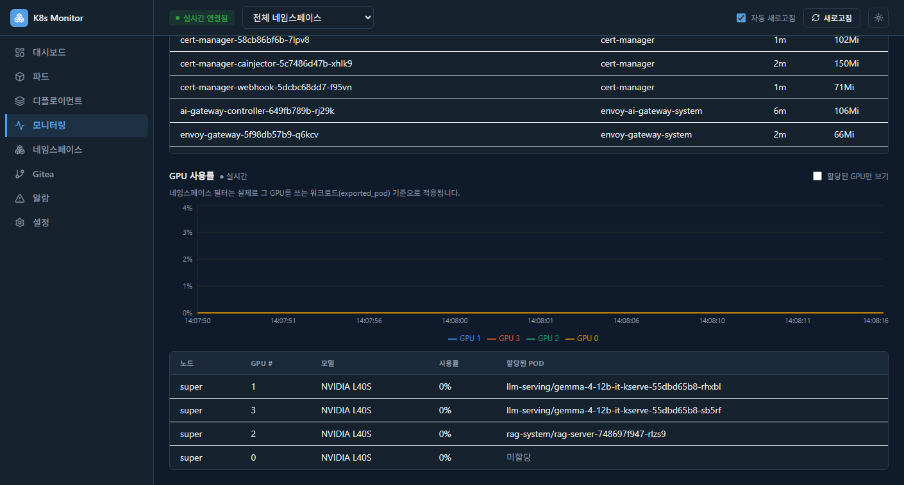
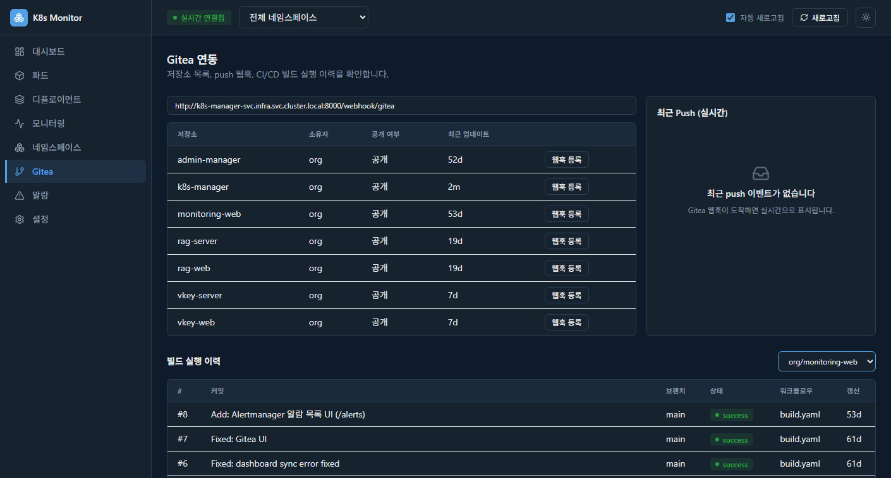
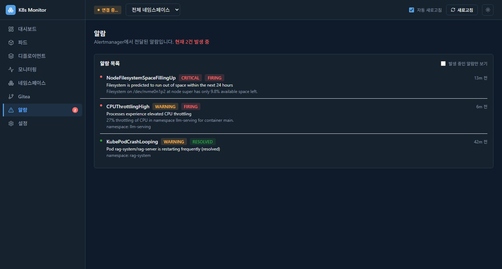
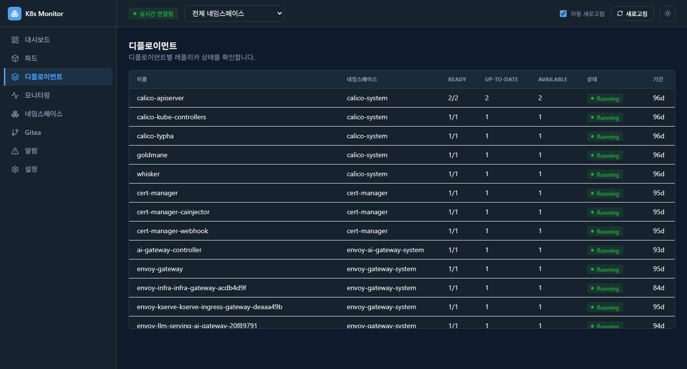
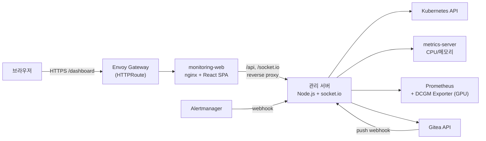
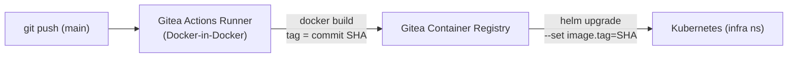

# K8s Monitoring Web

GPU 서버 기반 Kubernetes 클러스터를 운영하기 위한 **실시간 모니터링 대시보드**입니다.
LLM 서빙(KServe), RAG 서비스 등이 올라가 있는 실제 운영 클러스터(NVIDIA L40S × 4, 파드 약 70개)에 배포해 사용하고 있습니다.


> 이 저장소는 포트폴리오용 공개 사본입니다. 실제 운영 환경의 레지스트리 주소·조직명·도메인은
> `registry.example.com`, `org` 같은 placeholder로 치환했고, 스크린샷의 해당 정보도 같은 방식으로 가렸습니다.

## 프로젝트 개요

| 항목 | 내용 |
|---|---|
| 기간 | 2026.08 ~ 2026.09 |
| 역할 | 프론트엔드 개발, 컨테이너화, Helm 차트, CI 파이프라인 구성, 운영 배포 (1인) |
| 백엔드 | 별도 저장소의 관리 서버(Node.js/Express + socket.io)와 REST/WebSocket으로 연동 |
| 배포 환경 | 단일 노드 kubeadm 클러스터, Envoy Gateway(Gateway API), Gitea + Gitea Actions |

**문제** — 클러스터 상태를 보려면 `kubectl`이나 Prometheus 쿼리를 직접 다뤄야 해서, 서버를 운영하는 사람만 상태를 확인할 수 있었습니다.
특히 GPU가 어떤 워크로드에 할당돼 있고 얼마나 쓰이는지 파악하기가 어려웠습니다.

**해결** — 파드/배포/네임스페이스 현황, CPU·메모리·GPU 사용량, CI 빌드 결과, Alertmanager 알람을 한 화면에서 실시간으로 보여주는 웹 대시보드를 만들었습니다.
AWS CloudWatch의 화면 구성을 참고했고, 라이트/다크 테마를 지원합니다.

## 주요 기능

| 화면 | 설명 |
|---|---|
| **대시보드** | 파드·디플로이먼트·네임스페이스·경고 이벤트 요약 카드, 리소스 사용량 Top 5, 최근 이벤트 |
| **파드** | 전체 파드의 상태, READY, 재시작 횟수, 노드, 기간 (`k8s:pods` 소켓 이벤트로 실시간 갱신) |
| **디플로이먼트** | 기대 레플리카 수 대비 실제 Ready/Available 수 비교 |
| **모니터링** | 파드 CPU Top 5 시계열 차트, 컨테이너별 리소스 사용량, **GPU별 사용률 차트와 할당된 파드 매핑** |
| **네임스페이스** | 네임스페이스별 파드 수 집계 |
| **Gitea** | 저장소 목록, push 웹훅 등록, Gitea Actions 빌드 실행 이력(커밋 단위, 실시간 반영) |
| **알람** | Alertmanager 알람 목록, severity/상태(firing·resolved) 구분, 사이드바 발생 건수 뱃지 |

<table>
  <tr>
    <td></td>
    <td></td>
  </tr>
  <tr>
    <td align="center">파드 CPU 사용량 Top 5 (실시간)</td>
    <td align="center">GPU별 사용률과 할당된 파드</td>
  </tr>
  <tr>
    <td></td>
    <td></td>
  </tr>
  <tr>
    <td align="center">Gitea 저장소와 CI 빌드 이력</td>
    <td align="center">Alertmanager 알람 목록 (예시 데이터)</td>
  </tr>
  <tr>
    <td></td>
    <td></td>
  </tr>
  <tr>
    <td align="center">파드 목록</td>
    <td align="center">디플로이먼트 목록</td>
  </tr>
</table>

## 아키텍처



- 프론트엔드는 정적 파일만 서빙하고, `/api`와 `/socket.io` 요청은 같은 파드 안의 nginx가 클러스터 내부 서비스로 리버스 프록시합니다. 브라우저가 백엔드 주소를 알 필요가 없고 CORS 설정도 필요 없습니다.
- 처음 화면에 들어오면 REST로 데이터를 받아오고, 이후에는 소켓 이벤트(`monitor:pods`, `monitor:gpu`, `k8s:pods`, `gitea:actions`, `alert:triggered`)로 갱신합니다.

### CI/CD



## 기술 스택

| 구분 | 사용 기술 |
|---|---|
| Frontend | React 18, Vite 5, React Router 7, Tailwind CSS 4 (CSS 변수 기반 테마) |
| 상태 관리 / 실시간 | zustand 5, socket.io-client 4 |
| 시각화 | Recharts 2 |
| 서빙 | nginx (`nginxinc/nginx-unprivileged`, non-root), envsubst 템플릿 |
| 배포 | Docker 멀티스테이지 빌드, Helm 3, Kubernetes, Gateway API (Envoy Gateway) |
| CI | Gitea Actions (self-hosted runner), Gitea Container Registry |
| 모니터링 연동 | metrics-server, Prometheus, NVIDIA DCGM Exporter, Alertmanager |

## 트러블슈팅

실제 운영 클러스터에 배포하면서 겪은 문제와 해결 방법입니다.

### 1. 네임스페이스로 필터링하면 GPU 사용률이 사라지는 문제

- **증상**: 상단에서 `llm-serving` 네임스페이스를 선택하면 그 네임스페이스의 모델 서버가 GPU를 쓰고 있는데도 GPU 표가 비어 버렸습니다.
- **원인**: DCGM Exporter 메트릭의 `namespace`/`pod` 라벨에는 **GPU를 쓰는 워크로드가 아니라 exporter 파드 자신**(`gpu-operator`)이 기록됩니다. 실제로 GPU를 점유한 워크로드 정보는 `exported_namespace`/`exported_pod` 라벨에 있었습니다.
- **해결**: GPU 메트릭은 항상 클러스터 전체를 조회하고, 화면에서 `exported_*` 라벨 기준으로 필터링하도록 바꿨습니다. 그 결과 GPU마다 "어떤 파드에 할당돼 있는지"도 함께 보여줄 수 있게 됐습니다.

### 2. 이미지 pull이 DNS 오류로 실패 (`ImagePullBackOff`)

- **증상**: `gitea.infra.svc.cluster.local`로 이미지 경로를 지정했더니 `Temporary failure in name resolution`이 발생했습니다.
- **원인**: 이미지 pull은 파드가 아니라 노드의 kubelet/containerd가 **호스트 네트워크**에서 수행합니다. 그래서 CoreDNS를 거치지 않고, `*.svc.cluster.local` 주소를 찾지 못합니다.
- **해결**: 이미지 경로를 게이트웨이의 외부 주소로 바꾸고, containerd에 레지스트리 설정(`/etc/containerd/certs.d/<host>/hosts.toml`)을 추가했습니다. 이때 `config.toml`의 `config_path`가 **두 군데**(CRI images, transfer 플러그인) 비어 있어서 둘 다 채워야 설정이 적용됐습니다.

### 3. `helm upgrade`를 해도 새 버전이 반영되지 않는 문제

- **원인**: `imagePullPolicy: IfNotPresent`인 상태에서 같은 태그로 이미지를 다시 push하면, 노드는 이미 그 태그의 이미지가 있다고 판단해 새로 받지 않습니다.
- **해결**: CI에서 **커밋 SHA를 이미지 태그로** 쓰도록 바꿨습니다. 커밋마다 태그가 달라지니 배포된 버전이 어떤 커밋인지도 바로 알 수 있습니다.

### 4. non-root nginx 컨테이너가 시작되지 않는 문제

- **증상**: `nginx:alpine`에 `USER nginx`만 지정했더니 `mkdir() "/var/cache/nginx/client_temp" failed (13: Permission denied)`가 발생했습니다.
- **해결**: non-root 실행을 전제로 만들어진 `nginxinc/nginx-unprivileged` 이미지로 교체했습니다. 기본 포트도 8080(비특권 포트)이라 Service의 `targetPort`를 그에 맞췄습니다.

### 5. `/dashboard` 하위 경로로 서빙하기

도메인의 `/` 경로는 Gitea가 이미 쓰고 있어서 대시보드는 `/dashboard` 경로로 노출해야 했습니다. 경로 설정을 네 군데에서 맞췄습니다.

- `vite.config.js`의 `base: '/dashboard/'` — 빌드된 JS/CSS 파일 경로
- React Router의 `basename: '/dashboard'` — 화면 이동 경로
- nginx의 `alias` + SPA fallback, `/`와 `/dashboard` 요청을 `/dashboard/`로 301 리다이렉트
- 개발 서버는 `base`를 라우팅에 적용하지 않아서, `/` → `/dashboard/` 리다이렉트 플러그인을 직접 만들어 운영 환경과 동작을 맞춤

### 6. 시계열 DB 없이 실시간 차트 그리기

백엔드가 현재 값만 내려주고 과거 값은 저장하지 않기 때문에, 브라우저에서 최근 30개 값을 쌓아 두고 차트를 그립니다.
소켓 push가 오면 그 값을 쓰고, GPU는 소켓 push가 없을 때 10초 주기 REST 폴링으로 대신합니다.
차트 색은 순위가 아니라 **처음 나타난 순서대로** 정해서, Top 5 순위가 바뀌어도 같은 파드의 선 색이 유지되게 했습니다. 팔레트는 색각 이상이 있어도 구분되는 8색으로 골랐습니다.

### 7. Alertmanager 알람이 중복으로 쌓이는 문제

Alertmanager는 같은 알람이 발생(firing)할 때와 해소(resolved)될 때 웹훅을 각각 보냅니다.
알람의 `fingerprint`를 기준으로 기존 항목의 상태만 바꾸도록 해서, 같은 알람이 목록에 두 번 쌓이지 않게 했습니다.

## 프로젝트 구조

```
src/
├── config/        # API 클라이언트(백엔드 미응답 시 mock 데이터로 대체), mock 데이터
├── core/          # zustand 전역 상태, socket.io 클라이언트, 실시간 이벤트 연결 훅
├── features/      # 화면별 모듈 (dashboard, pods, deployments, monitoring, namespaces, gitea, alerts, settings)
│   └── <feature>/
│       ├── components/
│       ├── services/   # API 응답 → 화면용 데이터 변환
│       └── index.jsx
├── layout/        # Sidebar, Topbar, DashboardLayout
├── routes/        # 라우터 (basename: /dashboard)
└── shared/        # 공통 컴포넌트(TrendChart, DataTable 등), 유틸(차트 팔레트, 포맷터)
k8s/               # Helm 차트
.gitea/workflows/  # CI (빌드 → 레지스트리 push)
```

## 실행 방법

```bash
npm install
npm run dev
```

`http://localhost:5173/dashboard/`에 접속하면 됩니다. 백엔드가 없으면 REST 요청은 자동으로 mock 데이터로 대체되기 때문에 **백엔드 없이도 화면을 확인할 수 있습니다.**
실제 백엔드에 연결하려면 `VITE_K8S_API_PROXY` 환경 변수로 프록시 대상 주소를 지정합니다. 기본값은 `http://localhost:8000`입니다.

```bash
npm run build                                  # 프로덕션 빌드
docker build -t monitoring-web .               # 컨테이너 이미지
helm upgrade --install monitoring-web ./k8s \
  --namespace infra --set image.tag=<commit-sha>   # 클러스터 배포
```

배포에 필요한 클러스터 쪽 설정(레지스트리 인증, containerd, Gateway 연결)은 [docs/DEPLOYMENT.md](docs/DEPLOYMENT.md)에 정리했습니다.

## 한계와 개선 계획

- **알람 영속화**: 알람은 소켓으로 받은 것만 브라우저에 보관하기 때문에 새로고침하면 사라집니다. 백엔드에 PostgreSQL 저장소를 붙이고, 알람 그룹핑과 침묵(silence) 기능을 추가할 계획입니다.
- **GPU 사용률이 0%로 고정되는 문제**: 실제로 연산 중인 상황에서도 DCGM의 `DCGM_FI_DEV_GPU_UTIL` 값이 계속 0으로 수집되고 있습니다. 화면 문제가 아니라 Exporter 쪽 수집 문제로 확인해 원인을 조사하고 있습니다.
- **번들 크기**: 현재 하나의 번들이 약 770KB(gzip 230KB)입니다. 화면별 코드 분할(lazy route)과 차트 라이브러리 분리를 적용할 예정입니다.
- **빌드 로그 조회**: 지금은 빌드 단위 성공/실패만 보여주고, 단계별 로그는 보여주지 않습니다.
