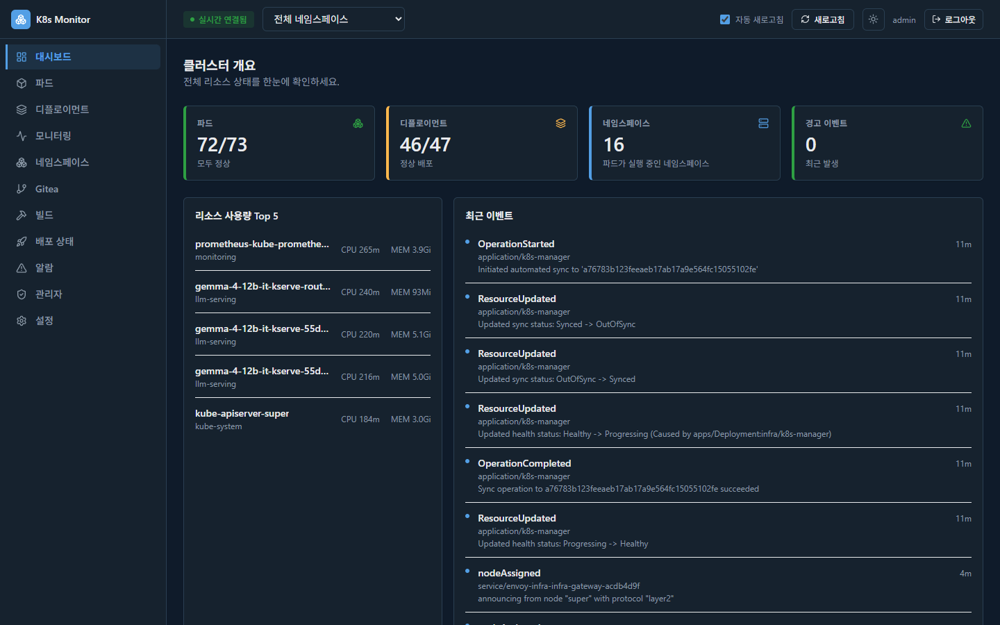
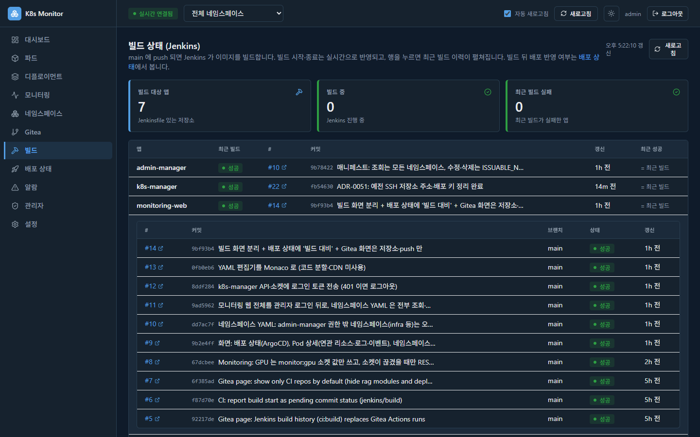
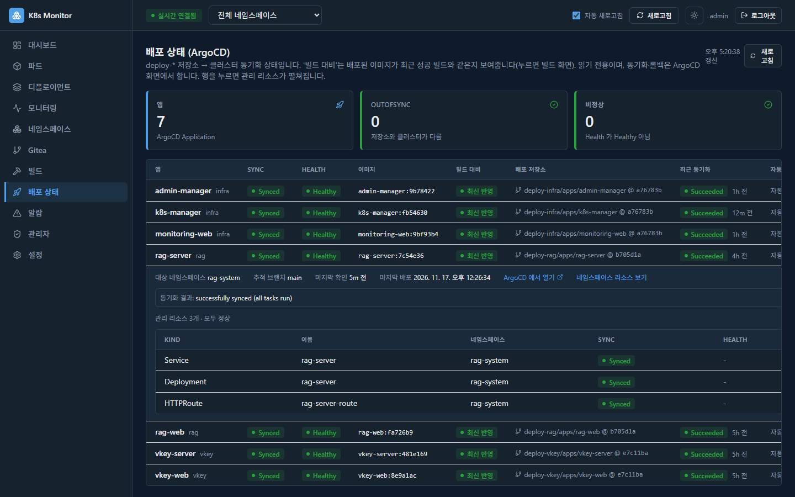
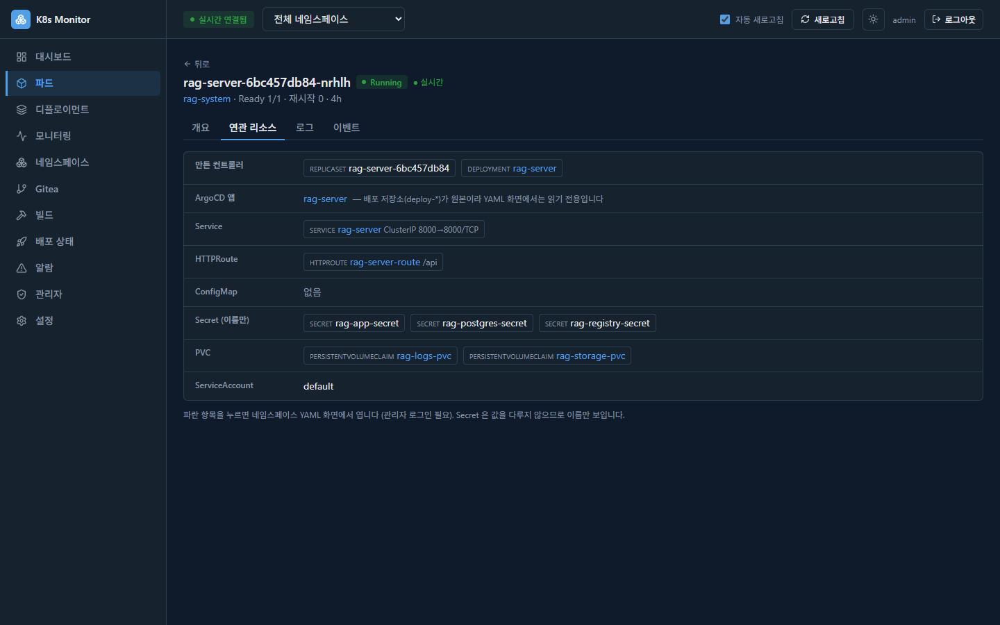
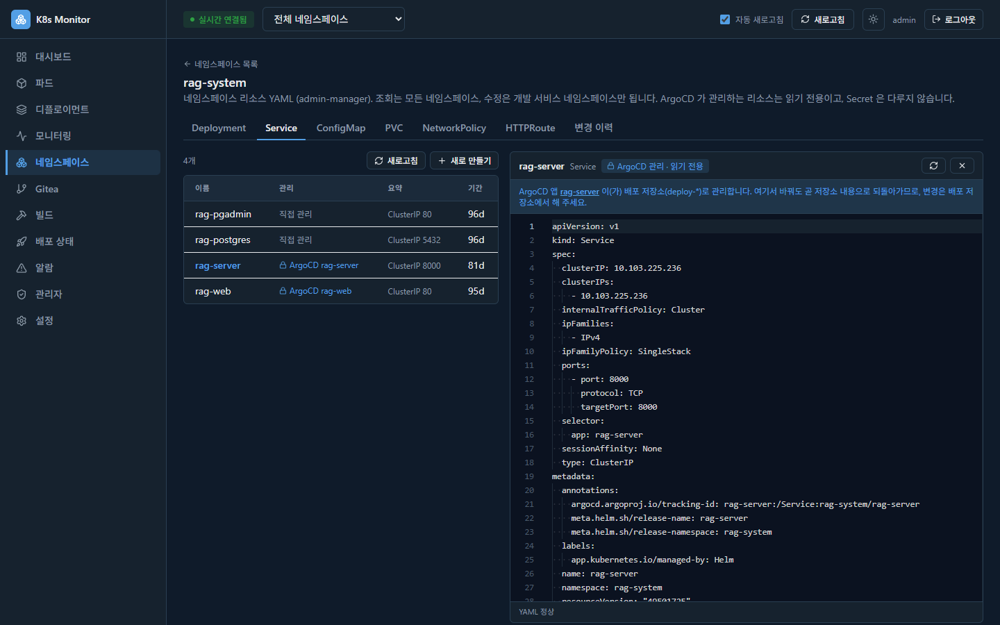
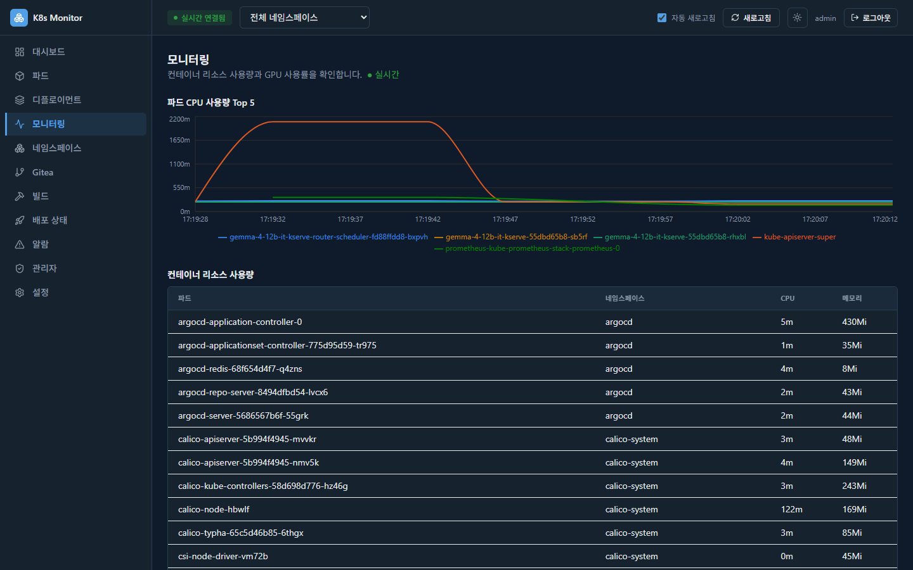
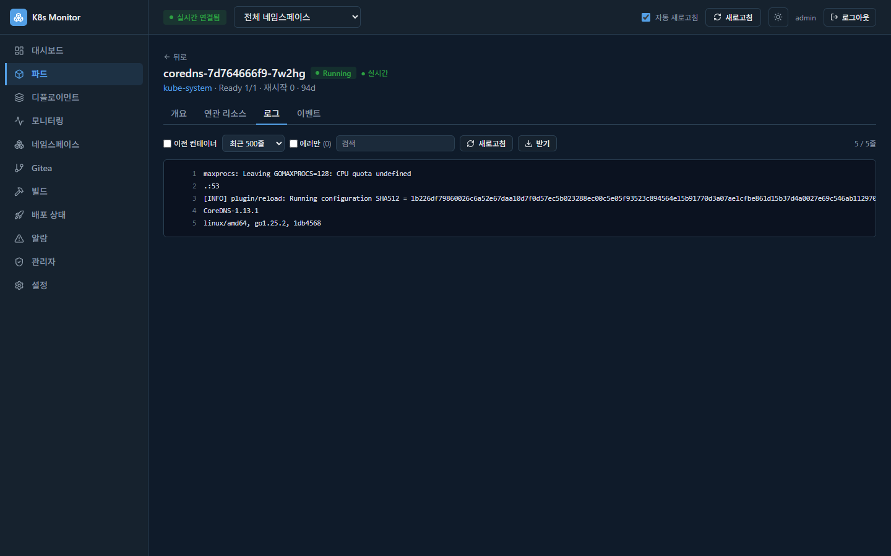
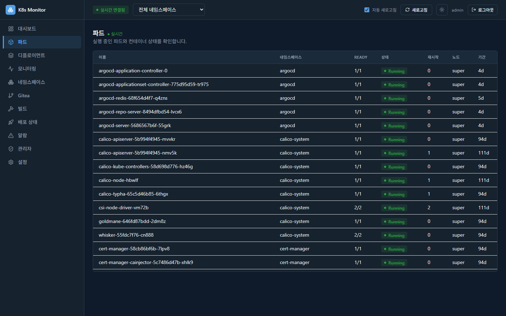
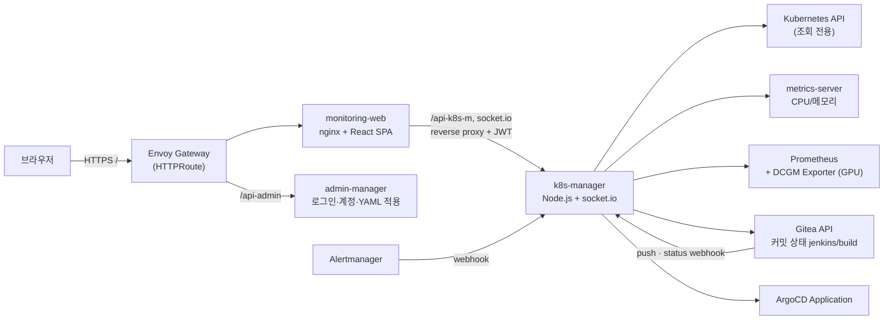
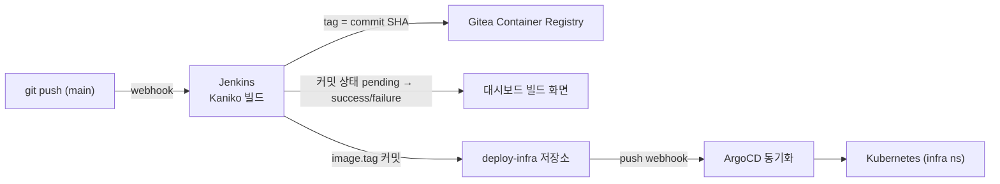

# K8s Monitoring Web

GPU 서버 기반 Kubernetes 클러스터를 운영하기 위한 **실시간 운영 대시보드**입니다.
LLM 서빙(KServe), RAG 서비스 등이 올라가 있는 실제 운영 클러스터(NVIDIA L40S × 4, 파드 약 70개)에 배포해 사용하고 있습니다.
처음에는 모니터링 화면으로 시작했고, 지금은 빌드·배포 상태, Pod 진단, 리소스 YAML 편집, 계정 관리까지 하는 운영 콘솔입니다.




> 이 저장소는 포트폴리오용 공개 사본입니다. 실제 운영 환경의 IP·도메인·조직명은 예시값(`10.0.0.x`, `example.ac.kr`, `myorg`)으로
> 치환했고, 스크린샷의 해당 정보와 로그인 사용자 이름도 가렸습니다. 스크린샷은 2026-11-17 운영 화면입니다(알람만 11-03 예시 데이터).
> 클러스터 전체 구성과 설계 기록은 [k8s-manager](https://github.com/milk024/k8s-manager)에 있습니다.

## 프로젝트 개요

| 항목 | 내용 |
|---|---|
| 기간 | 2026.08 ~ 2026.11 |
| 역할 | 프론트엔드 개발, 컨테이너화, CI/CD 구성, 운영 배포 (1인) |
| 백엔드 | 관리 서버 [k8s-manager](https://github.com/milk024/k8s-manager)(조회·실시간), [admin-manager](https://github.com/milk024/admin-manager)(로그인·계정 발급·YAML 적용) |
| 배포 환경 | 단일 노드 kubeadm 클러스터, Envoy Gateway(Gateway API), Gitea + Jenkins + ArgoCD |

**문제** — 클러스터 상태를 보려면 `kubectl`이나 Prometheus 쿼리를 직접 다뤄야 해서, 서버를 운영하는 사람만 상태를 확인할 수 있었습니다.
특히 GPU가 어떤 워크로드에 할당돼 있고 얼마나 쓰이는지, push한 코드가 지금 빌드 중인지·배포됐는지 파악하기가 어려웠습니다.

**해결** — 파드/배포/네임스페이스 현황, CPU·메모리·GPU 사용량, 빌드·배포 상태, 알람을 한 화면에서 실시간으로 보여주는 웹 대시보드를 만들었습니다.
이후 Pod 진단(연관 리소스·에러 로그), 네임스페이스 YAML 편집, 개발자 계정 발급까지 붙여 운영 콘솔로 키웠습니다. AWS CloudWatch의 화면 구성을 참고했고, 라이트/다크 테마를 지원합니다.

## 주요 기능

| 화면 | 설명 |
|---|---|
| **대시보드** | 파드·디플로이먼트·네임스페이스·경고 이벤트 요약 카드, 리소스 사용량 Top 5, 최근 이벤트 |
| **파드** | 전체 파드의 상태, READY, 재시작 횟수, 노드, 기간 (`k8s:pods` 소켓 이벤트로 실시간 갱신). 행을 누르면 Pod 상세 |
| **Pod 상세** | 컨테이너 상태·직전 종료 사유, **연관 리소스**(Deployment·Service·HTTPRoute·ConfigMap·Secret 이름·PVC·ArgoCD 앱), **에러 로그**(에러만 보기·스택 트레이스 포함·직전 크래시 컨테이너·검색·다운로드), 이벤트 |
| **디플로이먼트** | 기대 레플리카 수 대비 실제 Ready/Available 수 비교 |
| **모니터링** | 파드 CPU Top 5 시계열 차트, 컨테이너별 리소스 사용량, **GPU별 사용률 차트와 할당된 파드 매핑** |
| **네임스페이스** | 네임스페이스별 파드 수, 행을 누르면 **리소스 YAML 조회·편집**(Monaco, ArgoCD 관리 리소스는 읽기 전용) |
| **빌드** | Jenkins 빌드 대상 앱 전체의 최근 빌드(빌드 중·성공·실패), 빌드 번호, 최근 성공, 앱별 빌드 이력 |
| **배포 상태** | ArgoCD 앱별 Sync·Health·배포 이미지·관리 리소스, **빌드 대비**(최신 반영 / 배포 대기 / 빌드 중 / 빌드 실패) |
| **Gitea** | 저장소 목록, 웹훅 등록, 최근 push |
| **알람** | Alertmanager 알람 목록, severity/상태(firing·resolved) 구분, 사이드바 발생 건수 뱃지 |
| **관리자** | 개발자 K8s 계정(kubeconfig) 발급·회수, Gitea 사용자·팀 관리, 관리 작업 이력 |

사이트 전체가 관리자 로그인 뒤에 있습니다. 로그인은 탭 단위로 8시간 유지되고, 만료되면 자동으로 로그아웃됩니다.

<table>
  <tr>
    <td></td>
    <td></td>
  </tr>
  <tr>
    <td align="center">빌드 상태 — 앱별 최근 빌드와 펼친 빌드 이력</td>
    <td align="center">배포 상태 — ArgoCD 동기화와 빌드 대비, 관리 리소스</td>
  </tr>
  <tr>
    <td></td>
    <td></td>
  </tr>
  <tr>
    <td align="center">Pod 상세 — 연관 리소스</td>
    <td align="center">네임스페이스 YAML — ArgoCD 관리 리소스는 읽기 전용</td>
  </tr>
  <tr>
    <td></td>
    <td></td>
  </tr>
  <tr>
    <td align="center">파드 CPU 사용량 Top 5 (실시간)</td>
    <td align="center">GPU별 사용률과 할당된 파드</td>
  </tr>
  <tr>
    <td></td>
    <td></td>
  </tr>
  <tr>
    <td align="center">Pod 상세 — 로그 (에러만 보기·직전 컨테이너·검색·받기)</td>
    <td align="center">Gitea 저장소·웹훅·최근 push</td>
  </tr>
  <tr>
    <td></td>
    <td></td>
  </tr>
  <tr>
    <td align="center">파드 목록</td>
    <td align="center">Alertmanager 알람 목록 (예시 데이터)</td>
  </tr>
</table>

## 아키텍처



- 프론트엔드는 정적 파일만 서빙하고, `/api-k8s-m`과 socket.io 요청은 같은 파드 안의 nginx가 클러스터 내부 서비스로 리버스 프록시합니다. 브라우저가 백엔드 주소를 알 필요가 없고 CORS 설정도 필요 없습니다.
- 로그인 토큰(admin-manager JWT)은 REST 요청 헤더와 소켓 연결(`auth.token`)에 실려 가고, k8s-manager가 같은 키로 검증합니다. 401이면 화면이 로그인으로 돌아갑니다.
- 처음 화면에 들어오면 REST로 데이터를 받아오고, 이후에는 소켓 이벤트(`monitor:pods`, `monitor:gpu`, `k8s:pods`, `ci:build`, `gitea:push`, `alert:triggered`)로 갱신합니다.

### CI/CD



- 2026-11-12까지는 Gitea Actions Runner(DinD)가 빌드하고 `helm upgrade`로 배포했습니다. 지금은 Jenkins가 빌드하고, 배포 저장소의 이미지 태그만 바꾸면 ArgoCD가 반영합니다. push부터 반영까지 대기는 웹훅으로 수 초입니다.

## 기술 스택

| 구분 | 사용 기술 |
|---|---|
| Frontend | React 18, Vite 5, React Router 7, Tailwind CSS 4 (CSS 변수 기반 테마) |
| 상태 관리 / 실시간 | zustand 5, socket.io-client 4 |
| 시각화 / 편집 | Recharts 2, Monaco Editor (`@monaco-editor/react`, 앱 번들 내장), yaml |
| 서빙 | nginx (`nginxinc/nginx-unprivileged`, non-root), envsubst 템플릿 |
| 배포 | Docker 멀티스테이지 빌드, Kaniko, Jenkins, ArgoCD(GitOps), Gateway API (Envoy Gateway) |
| 모니터링 연동 | metrics-server, Prometheus, NVIDIA DCGM Exporter, Alertmanager |

## 트러블슈팅

실제 운영 클러스터에 배포하면서 겪은 문제와 해결 방법입니다.

### 1. 네임스페이스로 필터링하면 GPU 사용률이 사라지는 문제

- **증상**: 상단에서 `llm-serving` 네임스페이스를 선택하면 그 네임스페이스의 모델 서버가 GPU를 쓰고 있는데도 GPU 표가 비어 버렸습니다.
- **원인**: DCGM Exporter 메트릭의 `namespace`/`pod` 라벨에는 **GPU를 쓰는 워크로드가 아니라 exporter 파드 자신**(`gpu-operator`)이 기록됩니다. 실제로 GPU를 점유한 워크로드 정보는 `exported_namespace`/`exported_pod` 라벨에 있었습니다.
- **해결**: GPU 메트릭은 항상 클러스터 전체를 조회하고, 화면에서 `exported_*` 라벨 기준으로 필터링하도록 바꿨습니다. 그 결과 GPU마다 "어떤 파드에 할당돼 있는지"도 함께 보여줄 수 있게 됐습니다.

### 2. 이미지 pull이 DNS 오류로 실패 (`ImagePullBackOff`)

- **증상**: `gitea.infra.svc.cluster.local`로 이미지 경로를 지정했더니 `Temporary failure in name resolution`이 발생했습니다.
- **원인**: 이미지 pull은 파드가 아니라 노드의 kubelet/containerd가 **호스트 네트워크**에서 수행합니다. 그래서 CoreDNS를 거치지 않고, `*.svc.cluster.local` 주소를 찾지 못합니다.
- **해결**: 이미지 경로를 게이트웨이의 외부 주소로 바꾸고, containerd에 레지스트리 설정(`/etc/containerd/certs.d/<host>/hosts.toml`)을 추가했습니다. 이때 `config.toml`의 `config_path`가 **두 군데**(CRI images, transfer 플러그인) 비어 있어서 둘 다 채워야 설정이 적용됐습니다.

### 3. 배포해도 새 버전이 반영되지 않는 문제

- **원인**: `imagePullPolicy: IfNotPresent`인 상태에서 같은 태그로 이미지를 다시 push하면, 노드는 이미 그 태그의 이미지가 있다고 판단해 새로 받지 않습니다.
- **해결**: CI에서 **커밋 SHA를 이미지 태그로** 쓰도록 바꿨습니다. 커밋마다 태그가 달라지니 배포된 버전이 어떤 커밋인지도 바로 알 수 있습니다. 이 태그 덕분에 나중에 "배포 이미지 = 최근 성공 빌드인지"를 비교하는 **빌드 대비** 표시도 만들 수 있었습니다.

### 4. non-root nginx 컨테이너가 시작되지 않는 문제

- **증상**: `nginx:alpine`에 `USER nginx`만 지정했더니 `mkdir() "/var/cache/nginx/client_temp" failed (13: Permission denied)`가 발생했습니다.
- **해결**: non-root 실행을 전제로 만들어진 `nginxinc/nginx-unprivileged` 이미지로 교체했습니다. 기본 포트도 8080(비특권 포트)이라 Service의 `targetPort`를 그에 맞췄습니다.

### 5. 하위 경로 서빙과 게이트웨이 경로 충돌

처음에는 도메인의 `/`를 Gitea가 쓰고 있어서 대시보드를 `/dashboard`로 노출했습니다(vite `base`, React Router `basename`, nginx `alias` + SPA fallback 네 군데를 맞춤).
2026-11-12 경로 재배치로 대시보드가 `/`, Gitea가 `/gitea`, 백엔드가 `/api-k8s-m`으로 옮겼습니다.
이후 ArgoCD 배포 상태 화면을 `/argocd`로 만들었다가, 게이트웨이가 `/argocd`를 ArgoCD 본체로 보내서 **새로고침하면 ArgoCD UI가 열리는** 문제가 있었습니다. 화면 경로를 `/deploy-status`로 바꿔 해결했습니다.

### 6. 시계열 DB 없이 실시간 차트 그리기

백엔드가 현재 값만 내려주고 과거 값은 저장하지 않기 때문에, 브라우저에서 최근 30개 값을 쌓아 두고 차트를 그립니다.
차트 색은 순위가 아니라 **처음 나타난 순서대로** 정해서, Top 5 순위가 바뀌어도 같은 파드의 선 색이 유지되게 했습니다. 팔레트는 색각 이상이 있어도 구분되는 8색으로 골랐습니다.
GPU는 원래 10초 REST 폴링도 같이 돌았는데, 백엔드가 이미 5초마다 소켓으로 보내고 있어 **중복 요청**이었습니다. 소켓이 연결돼 있으면 폴링을 멈추고, 끊겼을 때만 REST로 대신하게 바꿨습니다.

### 7. Alertmanager 알람이 중복으로 쌓이는 문제

Alertmanager는 같은 알람이 발생(firing)할 때와 해소(resolved)될 때 웹훅을 각각 보냅니다.
알람의 `fingerprint`를 기준으로 기존 항목의 상태만 바꾸도록 해서, 같은 알람이 목록에 두 번 쌓이지 않게 했습니다.

### 8. 빌드 결과를 실시간으로 받기 (Gitea Actions → Jenkins)

- **이전**: Gitea는 "빌드 완료" 웹훅이 없어서, push 웹훅을 받으면 서버가 2분 동안 Actions 상태를 짧게 폴링했습니다. 오래 걸리는 빌드는 결과가 화면에 안 왔습니다.
- **지금**: Jenkinsfile 첫 단계에서 커밋 상태를 `pending`(빌드 중)으로, 마지막에 `success/failure`로 남깁니다. Gitea가 이 변경을 **status 웹훅**으로 보내 주니 폴링 없이 시작·종료가 바로 반영됩니다.
- 주의할 점: 상태 조회 API는 값을 `status` 필드에, status 웹훅은 `state` 필드에 담아서 처음에는 목록이 전부 "빌드 없음"으로 보였습니다.

### 9. 빌드 요약 API가 55초 걸리던 문제

- **원인**: 앱 7개 × 커밋 10개의 상태를 **동시에** 불렀더니 Gitea가 몰린 요청에 느려졌습니다. 요청 하나하나는 0.1초 이하였습니다.
- **해결**: 앱마다 최신 커밋부터 하나씩 보다가 "최근 빌드"와 "최근 성공"을 찾으면 멈추게 했습니다(보통 앱당 2번). 여기에 10초 캐시와 stale-while-revalidate를 더해 첫 조회 약 5초, 이후에는 즉시 응답합니다.

### 10. 로그인을 붙이면서 화면이 깨지지 않게 배포하기

백엔드 API를 로그인 필수로 바꾸는 순간, 토큰을 안 보내는 예전 화면은 모두 401이 납니다. 그래서 **① 토큰을 보내는 화면 먼저 배포 → ② 백엔드에 검증 키 연결 → ③ 차단 코드 배포** 순서로 나눠서, 중간에 화면이 깨지는 구간 없이 전환했습니다.

### 11. Monaco 편집기를 CDN 없이, 첫 화면 크기 그대로

`@monaco-editor/react`는 기본으로 Monaco를 jsdelivr CDN에서 받습니다. 내부망 환경과 외부 의존을 피하려고 `loader.config({ monaco })`로 앱 번들에서 불러오게 했고, `React.lazy`로 **편집기를 열 때만** Monaco 청크(약 4MB)를 내려받게 했습니다. 첫 화면 번들 크기는 그대로입니다. YAML 파싱 오류는 행 번호와 함께 편집기 안에 빨간 밑줄(marker)로 표시합니다.

## 프로젝트 구조

```
src/
├── config/        # API 클라이언트(조회 화면은 백엔드 미응답 시 mock 데이터로 대체, 상세 화면은 오류 그대로), mock 데이터
├── core/          # zustand 전역 상태, socket.io 클라이언트(로그인 후 연결), 실시간 이벤트 연결 훅
├── features/      # 화면별 모듈
│   ├── dashboard, pods(+ PodDetailPage), deployments, monitoring, namespaces(+ NamespaceDetailPage)
│   ├── builds, argocd(배포 상태), gitea, alerts, admin, settings
│   └── <feature>/ components/ · services/(API 응답 → 화면용 데이터 변환) · index.jsx
├── layout/        # Sidebar, Topbar, DashboardLayout(로그인 게이트)
├── routes/        # 라우터
└── shared/        # 공통 컴포넌트(DataTable, Tabs, TrendChart, CodeEditor 등), 유틸(차트 팔레트, 포맷터)
Jenkinsfile        # Kaniko 빌드 → 커밋 상태 기록 → 배포 저장소 이미지 태그 bump
ci/                # 배포 저장소 bump 스크립트
```

## 실행 방법

```bash
npm install
npm run dev
```

`http://localhost:5173/`에 접속하면 됩니다. 실제 백엔드에 연결하려면 `VITE_K8S_API_PROXY` 환경 변수로 프록시 대상 주소를 지정합니다. 기본값은 `http://localhost:8000`입니다.
화면에 들어가려면 admin-manager 관리자 로그인이 필요합니다. 백엔드 없이 화면만 볼 때는 k8s-manager를 `AUTH_REQUIRED=false`로 띄우면 됩니다.

```bash
npm run build                                  # 프로덕션 빌드 (Monaco 는 별도 청크)
docker build -t monitoring-web .               # 컨테이너 이미지
```

운영 배포는 Jenkins(빌드) → 배포 저장소 이미지 태그 → ArgoCD(동기화)로 합니다. 노드 레지스트리 설정과 이전 Helm 직접 배포 방식은 [docs/DEPLOYMENT.md](docs/DEPLOYMENT.md), 환경 변수와 백엔드 연동 범위는 [docs/SETUP.md](docs/SETUP.md)에 정리했습니다.

## 한계와 개선 계획

- **알람 영속화·그룹핑·침묵**: 알람은 소켓으로 받은 것만 브라우저에 보관해서 새로고침하면 사라집니다. 단일 노드라 알람 수가 적어 그룹핑·침묵은 보류했고, 먼저 Alertmanager 메일 알림을 연결할 계획입니다.
- **GPU 사용률이 0%로 고정되는 문제**: 연산 중인 상황에서도 DCGM의 `DCGM_FI_DEV_GPU_UTIL` 값이 0으로 수집되는 경우가 있었습니다. 화면 문제가 아니라 Exporter 쪽 수집 문제로 보고 원인을 조사하고 있습니다.
- **로그인 MFA**: 지금은 아이디·비밀번호(로그인 시도 제한 포함)만 씁니다. 관리자 로그인에 MFA를 붙일 계획입니다.
- **번들 크기**: 메인 번들은 약 950KB(gzip 285KB)입니다. Monaco는 분리했고, 화면별 lazy route와 차트 라이브러리 분리가 남았습니다.
- **빌드 로그 조회**: 빌드 단위 상태와 Jenkins 링크까지만 보여주고, 단계별 로그는 Jenkins 화면에서 봅니다.
